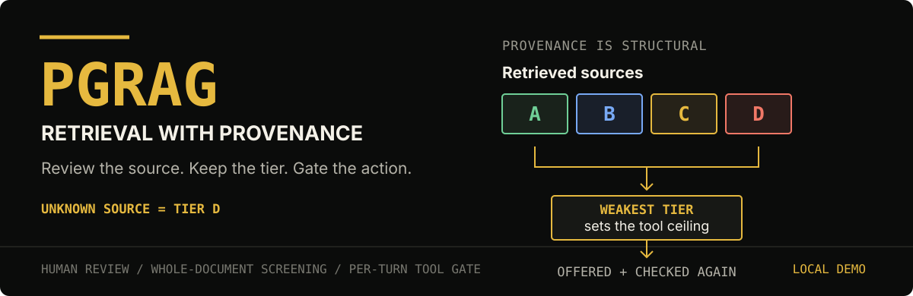
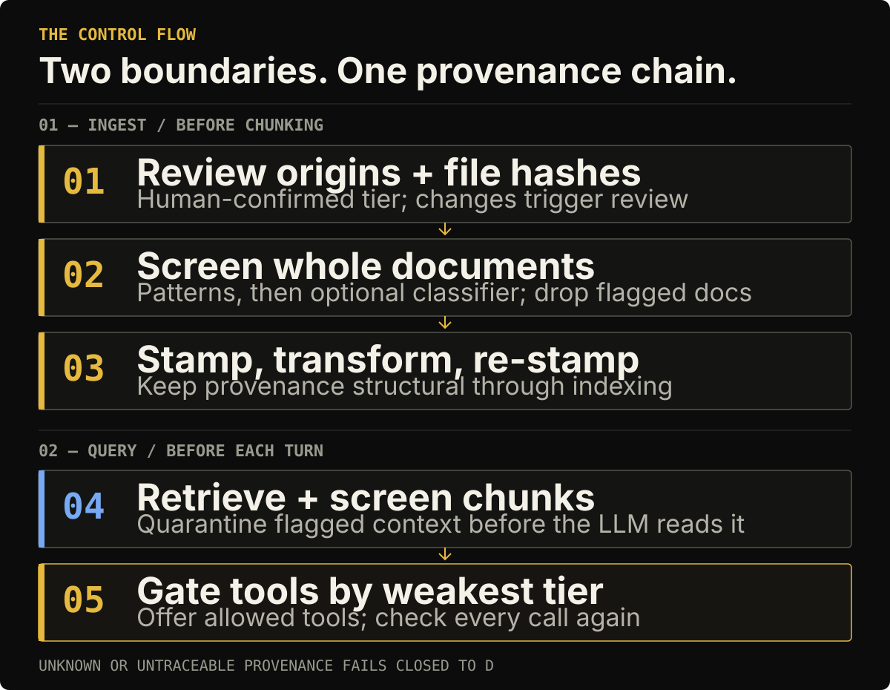

# Provenance-gated RAG

<p align="center">
  
</p>

The demo reviews document origins, screens whole documents before chunking, and limits tool access using the weakest provenance tier in retrieved context. It is a risk-reduction layer, not a claim that prompt injection can be prevented outright.

## The boundary

<p align="center">
  
</p>

The two checks answer different questions: **is this document eligible to enter the index?** and **what may this turn do with the sources it retrieved?** Unknown or untraceable provenance fails closed to tier `D`.

## What the project does

- **Reviews origins before indexing.** Each source folder gets a human-confirmed tier. File hashes bind that decision to the files the reviewer saw; additions, edits, and removals trigger another review.
- **Screens before chunking.** Pattern checks, followed by an optional local classifier, can discard a whole document. The LlamaIndex adapter also screens retrieved chunks as defense in depth.
- **Carries provenance as metadata.** Reserved tier fields are stripped from incoming metadata, kept out of prompts and embeddings, and re-applied after transformations.
- **Gates tools per turn.** The weakest tier among retrieved chunks determines which tools are offered. Calls are checked again before execution.

The demo's tools are intentionally mocked: they print what an action would do, rather than sending email, writing to a database, or making HTTP requests.

## Trust model

Origins are configured in `trust.yaml`. On first run, the project creates a commented starter file. Any unlisted origin defaults to `D`.

| Tier | Source class |
|:--:|---|
| `A` | User-authored |
| `B` | Internal documents |
| `C` | External, verified |
| `D` | External, unverified; also the default for unknown sources |

Editability can only lower a tier: `org-wide` caps at `C`; `anonymous` and undeclared editability cap at `D`; `immutable` and `authenticated-few` do not add a cap. Decisions expire after 90 days and are revisited when files, editability, or the computed tier changes.

Review decisions are versioned and HMAC-SHA256 signed. Each version links to the previous signature; the newest signature is also recorded beside the key, which is kept outside the project. A broken or unverifiable trail stops indexing. Back up the key directory with `decisions/` if you need to preserve the audit history.

## Run the demo

The demo uses Ollama for `qwen3:8b` generation and `nomic-embed-text` embeddings. The default injection classifier downloads its weights from Hugging Face on first use; `--no-classifier` skips that stage and uses pattern checks only.

```powershell
python -m venv .venv
.venv\Scripts\Activate.ps1
python -m pip install -r Requirements.txt
ollama pull qwen3:8b
ollama pull nomic-embed-text
```

Put `.txt`, `.md`, or `.pdf` files under `data/<origin-name>/`, with one folder per origin, then run:

```powershell
python demo/run.py
```

At the review screen, accept the computed tier, override it, or exclude the origin. Then ask a question; use `save <name>` to save the last answer and its sources. Run `python demo/run.py --no-classifier` to disable the optional model-based screening stage.

The Ollama models run locally. The first classifier use downloads model weights; no classifier request is sent to an API. The demo's tool functions are mocks and do not perform external actions.

## Limits

- Screening is not fact-checking. A false claim with no detected instruction can still be indexed and retrieved.
- Pattern checks are English-oriented and can miss instructions without recognizable AI-facing wording. The optional default classifier is `protectai/deberta-v3-base-prompt-injection-v2`; its model card describes it as English-only and archived. The repository's tests use a fake classifier, not the real weights.
- The demo gates each turn from that turn's retrieved chunks; it does not carry provenance across conversation memory.

## Tests

```bash
pytest
```

The current suite collects 313 tests across the registry, signing, freshness, sanitizer, adapter, review gate, and capability gate. Tests use fakes and do not require running Ollama or downloading model weights.

<details>
<summary>Implementation map</summary>

| Path | Responsibility |
|---|---|
| `pgrag/core/registry.py` | Trust tiers, editability caps, review expiry, file hashes, decisions |
| `pgrag/core/signing.py` | Signed, versioned decision history |
| `pgrag/core/sanitizer.py` | Whole-document and text screening |
| `pgrag/core/capability_gate.py` | Tool eligibility from the weakest tier in context |
| `pgrag/adapters/llamaindex.py` | Stamp/restamp, metadata hiding, retrieved-node screening, gated turns |
| `pgrag/adapters/injection_classifier.py` | Optional local second-stage classifier |
| `pgrag/cli.py` | Rich terminal review interface and PGRAG wordmark |
| `demo/run.py` | Ollama + LlamaIndex interactive demo |
| `demo/tools.py` | Mock actions used by the demo |
| `tests/` | Regression and behavioral tests |

`Requirements.txt` pins dependency versions because changes in LlamaIndex metadata handling can affect the provenance boundary. Upgrade dependencies deliberately and rerun the suite.

</details>
